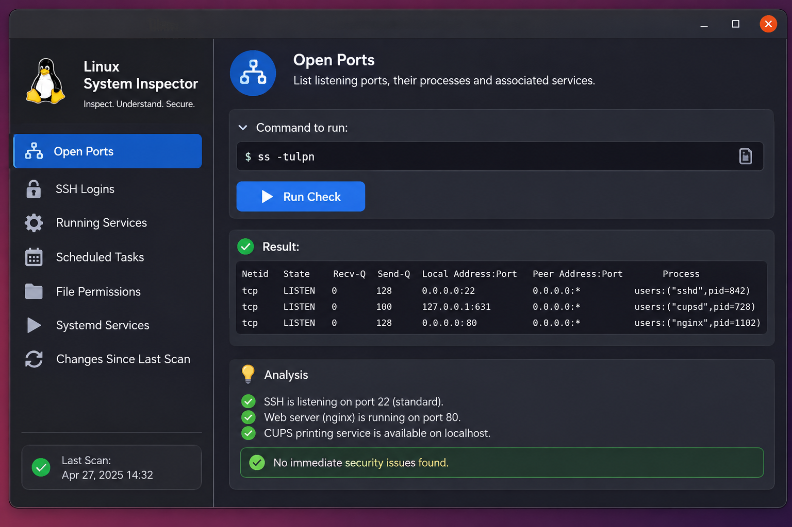

# LinuxSystemDetector – avoin graafinen tietoturvan tarkastus- ja hallintatyökalu Linuxille

LinuxSystemDetector avoimen lähdekoodin graafinen Linux-työpöytäsovellus, joka kokoaa järjestelmän tietoturvan tarkastelun, analysoinnin ja hallinnan yhteen helppokäyttöiseen käyttöliittymään. Tekninen toteutus perustuu **Electroniin, Reactiin ja Node.js:ään**.

Linux-järjestelmien tietoturvan tarkastelu perustuu nykyisin suurelta osin erillisiin komentorivityökaluihin ja järjestelmänhallintaohjelmiin. Esimerkiksi avoimien verkkoporttien, käynnissä olevien palveluiden, SSH-kirjautumisten, tiedostojen käyttöoikeuksien ja järjestelmäpalveluiden tarkastelu tapahtuu useilla eri työkaluilla, kuten UFW:llä ja Lynisillä. Tietojen kokoaminen ja tulosten ymmärtäminen edellyttävät käyttäjältä usein komentojen, työkalujen ja Linux-järjestelmän tuntemusta.

LinuxSystemDetectorin tavoitteena on koota nämä tarkastelut yhteen helppokäyttöiseen graafiseen käyttöliittymään ja tehdä samalla tarkastusprosessista läpinäkyvä käyttäjälle.

Linux System Detector pyrkii madaltamaan tätä kynnystä. Sovellus näyttää käyttäjälle tarkistuksessa suoritettavan komennon ennen sen ajamista, selittää komennon tarkoituksen ja antaa käyttäjän käynnistää tarkistuksen itse. Tulokset esitetään graafisesti ja niihin liitetään ymmärrettävä analyysi.

Tavoitteena on tehdä tästä sovelluksesta helppokäyttöinen jopa Linux-aloittelijoille ja ensi kertalaisille.

## Sovelluksen käyttöliittymä

## Keskeiset toiminnallisuudet

* **Avoimet verkkoportit**: Kuuntelevien verkkoporttien ja niitä käyttävien prosessien tunnistaminen.
* **SSH-kirjautumiset ja asetukset**: SSH-todennusasetusten ja viimeaikaisen kirjautumistoiminnan tarkastelu.
* **Käynnissä olevat palvelut**: Aktiivisten järjestelmäpalveluiden näyttäminen.
* **Ajastetut tehtävät**: Cron-ajastusten ja niiden suorittamien skriptien tarkastelu.
* **Tiedostojen käyttöoikeudet**: Tiedostojen omistajuuden ja käyttöoikeuksien tarkistaminen.
* **systemd-palvelut**: Palveluiden määritysten, käynnistysasetusten ja tilan tarkastelu sekä turvallisuusasetusten analysointi.
* **Muutokset edelliseen tarkistukseen**: Nykyisten tarkastustulosten vertaaminen aiemmin paikallisesti tallennettuihin tuloksiin.

## Keskeiset suunnitteluperiaatteet

### Läpinäkyvyys
Käyttäjän tulee ymmärtää, mitä järjestelmässä tarkastetaan, mitä komentoja suoritetaan ja miksi tarkistus tehdään.

### Yksityisyys ja käyttäjän hallinta
Linux System Detector toimii ensisijaisesti paikallisesti.
Se ei vaadi pilvitilejä, ulkoisia palveluita eikä telemetriaa. Tarkastustiedot ja skannaushistoria pysyvät käyttäjän omassa järjestelmässä.
Käyttäjät päättävät itse, milloin tarkastukset suoritetaan ja mitä tietoja he haluavat tarkastella.
Suoritettavat komennot näytetään käyttäjälle ennen suorittamista. Käyttäjä voi tarkastella komentoa ja sen tarkoitusta ennen hyväksymistä.
Linux System Detector on puhtaasti vain luku -tyyppinen tarkastustyökalu.
Sillä ei ole oikeuksia eikä toiminnallisuutta muuttaa järjestelmäasetuksia, tiedostoja, palveluita, palomuurisääntöjä, käyttäjätilejä tai muita järjestelmän kokoonpanoja.

Sovellus ei käytä tietokantaa. Se tallentaa uusimmat tarkastustulokset paikallisesti tiedostoon, mikä mahdollistaa aiempien tulosten tarkastelun ja niiden vertailun uusiin tarkastuksiin.
Kaikki tarkastustiedot säilyvät käyttäjän tietokoneella. Pilvipalveluita tai ulkoisia tilejä ei tarvita.

### Ymmärrettävyys
Tekniset havainnot esitetään selkokielisinä selityksinä, työkaluvihjeinä ja korjausehdotuksina.

## Sovelluksen käyttäminen

Jokainen tarkastus noudattaa läpinäkyvää työnkulkua:
1. Valitse tarkastus sovellusvalikosta. 
2. Lue kuvaus, jossa selitetään, mitä tarkastetaan ja miksi. 
3. Tarkista tarkka komento ennen suorittamista. 
4. Käynnistä tarkastus manuaalisesti napsauttamalla Suorita-painiketta. 
5. Tarkastele tuloksia, mukaan lukien alkuperäinen komentotuloste ja selitys havainnoista. 
6. Tutustu ehdotettuihin jatkotoimenpiteisiin, jos jotain huomionarvoista havaitaan.

## Yhteiskunnallinen ja teknologinen merkitys

Hankkeella edistetään avoimen Linux-teknologian käytettävyyttä, tietoturvaosaamista ja järjestelmien itsenäistä hallintaa.

Tavoitteena on kehittää työkalu, joka palvelee sekä Linux-harrastajia että opiskelijoita, kehittäjiä ja järjestelmän ylläpitäjiä. Sovellus tukee myös oppimista tekemällä käyttöjärjestelmän toiminnasta ja tietoturvan merkityksestä näkyvää ja ymmärrettävää.

Hankkeen tuloksena syntyvä ohjelmisto on tarkoitus julkaista avoimena lähdekoodina, jotta sitä voidaan hyödyntää, arvioida ja jatkokehittää myös laajemmin Linux-yhteisössä.

## Tarkastuksen lopputulos

LinuxSystemDetectorin tavoitteena on muodostaa käyttäjälle helposti ymmärrettävä tilannekuva Linux-järjestelmän tietoturvasta, sen keskeisistä suojausasetuksista ja mahdollisista poikkeamista – ilman, että käyttäjältä edellytetään syvällistä Linux-osaamista. Kaikki perus palvelut ns. "saman katon alta".